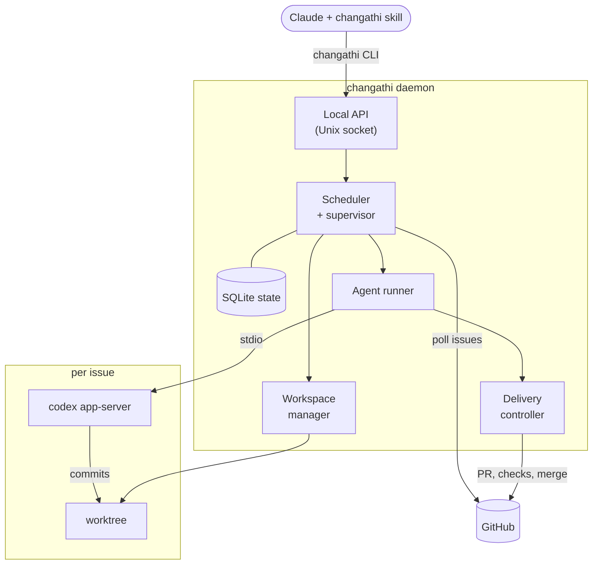
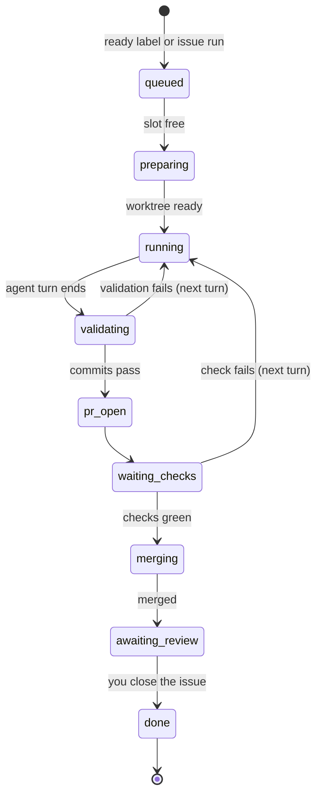
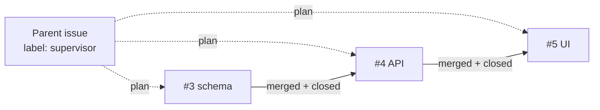

# Changathi

Changathi is a personal coding-agent orchestrator. One Go daemon watches GitHub issues across your repositories, runs a Codex agent on each one in its own Git worktree, validates the agent's commits, opens a PR and merges it when checks pass. The issue then stays open with `agent:review` until you review the result and close it.

You don't drive it by hand. The CLI is built for Claude: install the bundled skill and ask Claude to onboard repositories, write issues, and check on or steer agents. This README covers installation and how the system fits together; the day-to-day procedures live in the skill ([skills/changathi/SKILL.md](skills/changathi/SKILL.md)).

## Getting started

### 1. Prerequisites

- macOS or Linux
- Go 1.26+, Git
- [GitHub CLI](https://cli.github.com/) (`gh`), logged in
- [Codex CLI](https://github.com/openai/codex) (`codex`), logged in (tested with `codex-cli 0.160.0`)

Log in as the OS user that will run the daemon:

```sh
gh auth login
codex login
```

### 2. Build and put it on your PATH

```sh
git clone <this repository> ~/repos/changathi
cd ~/repos/changathi
make build                                   # writes bin/changathi
mkdir -p ~/.local/bin
ln -sf "$PWD/bin/changathi" ~/.local/bin/changathi
changathi doctor                             # checks git, gh and codex are installed and authenticated
```

Because `~/.local/bin/changathi` is a symlink, later rebuilds update it in place.

### 3. Run the daemon as a service

```sh
changathi daemon install                     # writes the service, starts it, waits until the daemon answers
```

On macOS this writes the launchd agent `~/Library/LaunchAgents/dev.changathi.plist` and loads it; on Linux it writes the systemd user unit `~/.config/systemd/user/changathi.service` and enables it. The service runs the `changathi` on your PATH, and its `PATH` covers `git`, `gh`, `codex` and the rest of your current shell's `PATH`, so validation commands find the same tools as your terminal. Run install from a shell where those resolve.

It is safe to re-run: if nothing changed it leaves the running daemon alone, otherwise it rewrites the file and restarts the service. Use `--print` to see the file without installing it, and `changathi daemon uninstall` to stop and remove the service (state in the data directory is kept). Logs go to `~/Library/Logs/changathi.log` and `changathi.error.log` on macOS and to `journalctl --user -u changathi` on Linux.

After rebuilding, restart it so it loads the new binary:

```sh
make build && launchctl kickstart -k gui/$(id -u)/dev.changathi   # macOS
make build && systemctl --user restart changathi                 # Linux
```

For a quick try without a service, run `changathi daemon start` in a terminal and leave it open.

### 4. Install the Claude skill

```sh
changathi skill install                      # ~/.claude/skills/changathi/SKILL.md
```

Use `--dir <repo>` to install it into one repository's `.claude/skills/` instead. The skill is embedded in the binary, so reinstall it after each rebuild to keep it in step with the CLI.

### 5. Add your first repository

Each repository needs a `WORKFLOW.md` on its **default branch** that tells Changathi how to prove a change is good:

```markdown
---
validation:          # required; run after every agent turn
  - go test ./...
  - go vet ./...
---
Implement issue #{{.Issue.Number}}: {{.Issue.Title}}.
Follow AGENTS.md and existing repository conventions.
```

[examples/WORKFLOW.md](examples/WORKFLOW.md) shows every option. Then register the repository:

```sh
changathi project add backend --repo owner/backend --auto
```

`project add` creates the `agent:ready`, `agent:review` and `supervisor` labels and warns if `WORKFLOW.md` is missing. With `--auto`, any open issue labelled `agent:ready` is picked up; without it, issues run only when dispatched with `changathi issue run 'backend#42'`.

Simplest of all: open Claude in the repository and ask it to onboard the repo to Changathi. The skill walks it through writing `WORKFLOW.md`, registering the project and writing issues an agent can finish.

### 6. Hand it work

```sh
gh issue create --repo owner/backend --title 'Handle empty input' --body-file issue.md --label agent:ready
changathi summary
```

From here, ask Claude how things are going. It uses `summary`, `agent logs` and `agent message` to report and steer, and leaves closing issues to you.

## How it works

### Components



- **Local API.** Versioned HTTP over `<data_dir>/daemon.sock`, readable only by your user. The CLI is a thin client; quitting it never stops agents.
- **Scheduler.** Polls GitHub every 30 seconds, round-robins between projects, and enforces global and per-project concurrency (both default to 1). Retry, CI and account-limit waits don't hold a slot.
- **Workspace manager.** Keeps its own clone of each repository, separate from your checkout, and gives every issue a branch and worktree. Worktrees are never deleted automatically.
- **Agent runner.** Starts a `codex app-server` per attempt with a reduced environment and no copied credentials, streams its events to a per-attempt log, and steers or queues your messages.
- **Delivery controller.** Takes the agent's commits, runs validation, publishes the PR and merges it.
- **Supervisor.** Coordinates a parent issue's plan of dependent child issues. It is plain daemon logic and doesn't use an agent slot.
- **State store.** One SQLite database holds projects, attempts, messages, events and journaled GitHub operations, so the daemon can restart without losing or duplicating work.

### Life of an issue



1. **Pickup.** An issue becomes eligible through the `agent:ready` label (auto projects) or an explicit `issue run`. Eligibility is re-checked against GitHub before dispatch and before delivery, so closing the issue or cancelling it stops the work.
2. **Agent turn.** Codex works in the issue's worktree and commits. It is told not to push, open PRs or close issues.
3. **Validation.** Changathi merges the latest base branch, runs the `validation` commands from `WORKFLOW.md`, and requires a clean tree with new commits. A failure becomes the next turn's prompt, up to `max_turns`.
4. **Delivery.** Changathi pushes the branch, opens `[Changathi] <issue title>`, waits for `required_checks` and GitHub's mergeability, and merges with the validated head SHA pinned. A failing check sends the agent back to work in the same Codex thread.
5. **Review.** After merge the issue keeps `agent:review` and stays open. You review and close it; closing is the only human gate.

Anything that can't proceed on its own (exhausted turns, a merge blocked by branch protection, an execution lock still held after a restart) becomes `needs_attention`. An account limit pauses all dispatch for five minutes (`waiting_account`) instead of failing the work.

### Dependent issues

A parent issue labelled `supervisor` holds a plan: which child issues to run and what each depends on. The supervisor dispatches a child once its prerequisites are merged **and** closed by you, so nothing builds on unreviewed work. See [examples/supervisor-issue.md](examples/supervisor-issue.md) for a plan and [SUPERVISOR_SPEC.md](SUPERVISOR_SPEC.md) for the full rules, including evidence approval for operational tasks.



### Trust model

Worktrees isolate Git changes, not processes. Codex runs unattended as the daemon's OS user (`approvalPolicy=never`, `sandbox=danger-full-access`), and validation commands run as that user too. Only register repositories whose code and workflow commands you trust. `WORKFLOW.md` is always read from the base branch, so an agent can't change its own policy by editing it. GitHub branch protection still applies; Changathi never bypasses required reviews.

## State and configuration

Everything lives under `~/.local/share/changathi`:

| Path | Contents |
| --- | --- |
| `state.db` | SQLite: projects, attempts, messages, events, operations |
| `daemon.sock`, `daemon.lock` | API socket and single-daemon lock |
| `repos/<project-id>` | Changathi's own clone of each repository |
| `worktrees/<project-id>/<attempt-id>` | One worktree per execution |
| `logs/<attempt-id>.log` | Agent transcript, rotated at 16 MiB |

To change the data directory, poll interval, global concurrency or Codex path, pass `--config` with a YAML file like [examples/config.yaml](examples/config.yaml); the CLI and daemon must agree on `--data-dir`. Keep the data directory on local disk, and don't point two daemons at the same repositories.

Worktrees are kept after failures. `changathi workspace clean <agent-id>` previews removal of a delivered worktree, and `--apply` removes it.

## Development

```sh
make test                                    # go test -race ./...
make vet
CHANGATHI_CODEX_SMOKE=1 go test ./internal/provider -run TestInstalledCodexHandshake -v
```

The smoke test checks the protocol handshake with your installed Codex without running a model turn. Automated tests use a fake provider and never touch real GitHub repositories.

| Package | Role |
| --- | --- |
| `cmd/changathi` | Entry point |
| `internal/cli` | Cobra commands, compact output, skill install |
| `internal/service` | Daemon: API server, scheduling and delivery engine, supervisor |
| `internal/core` | Models, SQLite store, GitHub (`gh`) adapter, workflows, worktrees |
| `internal/provider` | Provider interface and Codex app-server adapter |
| `internal/transcript` | Turns provider events into readable logs |
| `skills/changathi` | The embedded Claude skill |

## Limits and further reading

GitHub.com only, Codex only (Claude is a planned provider), one repository per project, and the daemon is reached locally or over SSH. [SPEC.md](SPEC.md) is the full design with notes on where the implementation differs, [SUPERVISOR_SPEC.md](SUPERVISOR_SPEC.md) covers dependent issues, and [SHARED_MEMORY_SPEC.md](SHARED_MEMORY_SPEC.md) is a proposal that isn't implemented yet.
